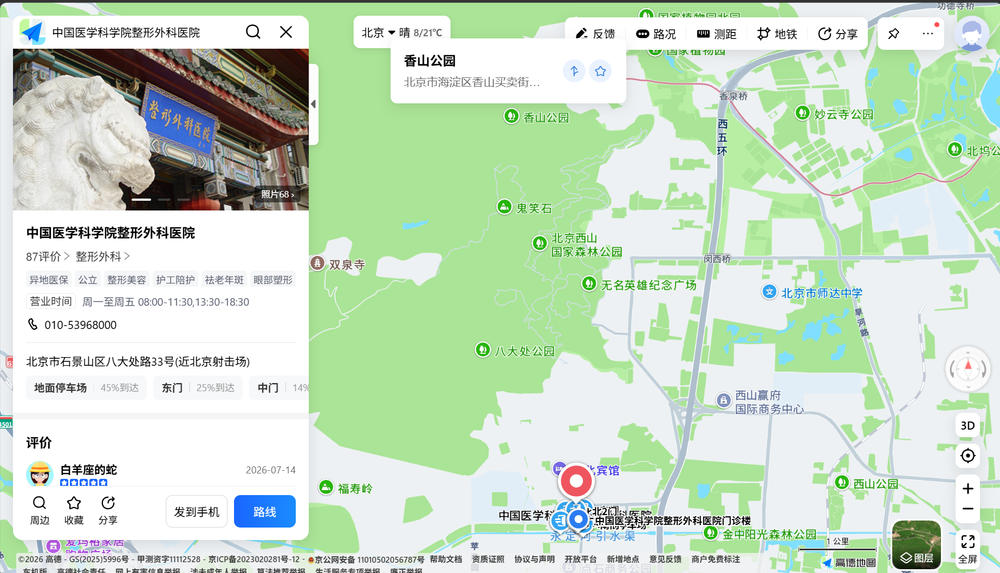

## 【材料一】金星自传《半梦》中“1993~1997：重回故国”篇

### 1.做个真正女人

过了1995年春节后，医院来电话，说高干病房有位子了，你住院吗？我听说后，大年初一就收拾行装，去医院了。成方圆知道我要做变性手术，还劝我说：“你现在不是可以吗？干吗要做那样的手术？”我说：“我不满足于自己的生命只做到可以，我要做就要做最好的，做到极致。”

临进医院那一天，朋友们来送我。我有一个很好的朋友，叫李小明，他是中央电视台东方时空的一个记者。从1993年《半梦》开始，他就开始跟拍我。他说：“我要记录你的生活。”

妈妈送我的时候，流下了眼泪。她这是在看儿子最后一眼，下次见到我，就是女儿啦。妈妈伏在门口的墙上哭了半天，她的内心是复杂的，她为我承受了很多痛苦。但妈妈很刚强，她不会说出来，她会支持，会让时间去消化。

在去香山医院的路上，我流下了眼泪。我是在感慨，我的这一生，让妈妈承担的太多；另外一个原因是，我就要告别自己的男儿身，同时也在感谢我的男儿身曾给了我28年的好经验。

我的朋友们谁也没有意识到我会做变性手术。因为我平时从来没有像娘娘腔似的说话，该是什么样的声音，就是什么样的声音，我从不扭捏作态。那些扭捏作态的是假女人。我做女人不是追求外在的东西，而是发自内心的愿望。这是一种本质上的区别。我的生理状况完全是男人的结构；可以勃起、射精、产生性交的欲望，但我从来没有和女人发生过任何关系。我产生性交欲望的对象，始终是男人。男人进入我的身体，我能达到一种快感，而当男人要求我进入他的身体时，我会产生反感，马上会陽痿。

我的角色是个女人。

这跟同性恋没有关系，而且，完全是一个女人的心理生存在男人的肢体里面。这种心理是非常特殊的。在没有变成女人之前，我的体毛是很重的，比一般男人的雄性特征还要明显。我是个串脸胡子，跟女孩跳舞的时候，女孩们还时常感叹，说我好性感。很多男孩子还羡慕我，说我的生殖器比一般男孩大。我还开玩笑说：“羡慕什么，放到我这里浪费了。”我的男性生理一切正常。我19岁时，经常赤裸着身体，站在镜子面前。我如果是一米八的身材，长得粗壮，我就不做手术了。但老天爷给了我一个女人的脸庞和女人的骨骼，所以，我毅然选择了变成女人。

我住进了北京香山医院中二病房。办完住院手术后，我又去北医三院去做心理检查。医生拿来一个册子，里面有1000多个问题让我来解答。回答很简单，是，还是不是。这都是些细小的琐事，有些问题是在重复地提问。这1000多个问题，如果回答对有60%的正确，你就有女性的倾向，但不适合做手术；过了75分，偏向女性，可以通过治疗纠正过来；过了80分，基本上达到女性标准，可以做手术了。我的分数算了一下，94分，医生说：你去做吧，一点问题也没有。我很理性，很多问题翻来覆去问，我都回答得一模一样。

### 2.父亲说：28年后，你找到了自己

我拿着心理测试单回到医院。医院看后，觉得做手术没有问题。但在做手术之前，我还在考虑一个问题，就是我的身份证 。我住院是以男性身份登记入院的。而我做了手术以后，我的身份证 如果没有变过来，是很大的麻烦事。这个时候，我就要跟我父亲摊牌。

正好，我的父亲到北京出公差，我打电话给父亲说：“我住院了。”

父亲说：“你住院干什么？”

我说：“治病。”

父亲问：“你得什么病了？”

我说：“你到医院来吧。”

于是父亲坐车来到香山医院。见了我的面，他问：“你是被烧伤了吗？怎么到整形医院来了？”

我说：“我要做变性手术，我要做女人了。”

父亲抽枝烟看着我，愣了两分钟，说：“总算对上号了。”

听了父亲的回答，我感到非常吃惊：“总算对上号了？什么意思？”

父亲说：“你知道吗，你小的时候，我怎么看你怎么像个女孩子。28年以后，你找到了你自己，对上号了，祝贺你！”

我在心里感叹道：原本我以为父亲的反应要超过母亲反应，因为我父亲是一个传统军人，而且，在父亲的三兄弟里，惟独他生了个儿子，金姓家族后嗣还要靠我来延续。我现在要改变性别，对父亲可能是一个打击。没有想到父亲如此开通，令我惊喜万分。

父亲说：“我能为你做些什么？”

我说：“你回去把我的身份证改过来吧！”

父亲便拿着我的身份证回沈陽了。他来到派出所，说：“我的儿子要变成女儿了。我是来给我的孩子改性别的。”

户籍科的人说：“我们从来没有碰到过这样的事情啊！”

父亲说：“那你现在就开始写历史吧！”

户籍科的人便把我的性别改了过来。

父亲打电话给我，说：“身份证给你办好了。”这时，我的心才完全安定下来，准备开始做手术。

手术分为三个部分：第一部分是胸部手术。这是经过外科手术进行隆胸。这也是杨主任最拿手的。杨主任让我选择隆胸硅胶材料，问我是做200克、250克还是300克。我先是挑了一件大号的。杨主任说：“太大，会影响你跳舞的。”我最后挑了200克和250克的。然后，我对跟拍我的记者朋友蒋越说：“明天我做手术，麻醉了就什么都不知道了，到时请你帮忙用一个男人的眼光看一看，是200克的好呢？还是250克的好？”蒋越说：“当然250克的好哦！”

第二天进行隆胸手术，跟拍的记者都穿上了白大褂，为了拍摄效果，手术室又增加了一些灯光，显得非常明亮。手术过程很顺利，硅胶假体完成后，我被送到病房。第二天，我站在镜子前观察自己，发现胸部的曲线变化了，我又接近了女性一步。

第二部分手术，是去掉毛发和喉结。去掉喉结的软骨时，我虽然打了麻药，但始终处在清醒状态。因为这个手术稍有差错，就会影响到我今后发声。所以，医生边做手术，边让我发出声音，直到成功地将两片软骨切割掉。我的喉结平坦了，消除了男性的特征。

下面是最痛苦的手术。为了彻底去掉毛发，必须把细胞里的毛囊破坏掉。要去掉嘴上的胡须，就要从嘴线处把肉皮翻开，然后，一根一根把毛囊剔出。但是，医生说：“我今天不能给你打麻药，一打麻药，你的嘴唇会肿，这样会影响缝线，容易缝歪。”我说：“那就不打麻药。”

手术开始，肉皮翻开一瞬间，钻心的疼啊！接着，一针一针剔出毛囊，这种疼痛又钻进了你的骨髓里。最后，缝合30针，前几针还很疼，过后几十针，我都不觉得疼痛了。一个摄影记者当时看了都晕过去了。我的朋友轻轻抚摩着我的手，传达着他们的安慰。手术过程中，我没有叫一声，因为我如果叫喊，会影响医生的情绪。手术完成后，我的朋友们说：“金星，你比江姐还要厉害啊！”当时，我完全是一种意念：你要变成女人，就必须过这一关。我一定要挺过去。

杨主任给我做手术时很专注、精细。一个护士 对我说：“杨主任给你做手术每一针都像绣花似的。”是的。原本两个小时的手术，她做了近四五个小时。

手术过程中，我掉了眼泪，这并不是痛苦的眼泪，而是因为护士漫不经心，把很钝的剪刀递给杨主任时落下的泪水。我是清醒的，我在做手术的时候，有两个护士在聊天，当杨主任问她们要剪刀时，她们把一把钝的剪刀递给杨主任。杨主任生气地说：“这么钝的剪刀，怎么能够用呢？”我们的护士太不敬业了，我为之感到伤心！这是我落泪的真实原因。

前两部分手术做得非常成功。准备做第三个手术的时候，杨主任犹豫了。杨主任说：“金星啊，还做下去吗？”我说：“杨主任，你是什么意思啊？”杨主任说：“你看，你的胸做完了，胡须和喉结也没有了，从外形上看，你完全是个女人了，你平时穿上女性的衣服，别人也不知道，就这样吧！”我说：“杨主任你是在开玩笑啊！这叫什么回事？这可真是男不男、女不女啦！我可不是泰国的人妖！”

杨主任说：“你要慎重考虑考虑。”我说：“我考虑好了。”我反复做杨主任的工作，给她增加信心。杨主任以前做过刚出生不久的双性人手术，但像我这样的变性手术从来没有做过。我从比利时带回来一个比较先进的手术方案，跟杨主任一起商量。我说：“我的生理条件和外国人有的地方是不一样的。”

于是，杨主任他们结合我的生理情况，制订了一套新的手术方案。医院所有的医生都聚在一起，共同研究这个新的课题。

### 3.凤凰涅磐

4月5日，清明节。那天谁都不做手术，说不吉利。我说：“他们嫌不吉利，我做手术。”护士 说：“金星，你要知道4月5号是清明节啊！”我说：“清明节怕什么？清明嘛，把多余的清除了也就明了啦！清明节做手术，是个好兆头。”

做手术的前一天，杨主任给我做检查，说：“你有多大把握？”我说：“50%。”杨主任问：那另外50%呢？我说：“我交给上天了。老天爷该怎么处置我就怎么处置我。”

杨主任摇了摇头。她看我这么坚决，这么清醒，没有任何犹豫，也只好认了。

第二天，履行手术前的责任签字。医生把责任单给我看了，里面有很多出现意外后果由自己承担的风险。我大略看后，毅然在上面签了字。这个时候，我真的把自己交给了老天爷，看老天怎么安排我今后的命运。

我是早晨9点进入手术室，全麻，整个手术做了16个小时。其中，我发生大出血四个小时，找不到血源，血直往外冒，只有不停地给我输血。这真应验了我有血光之灾。杨主任也辛苦，她跪着做了十几个小时的手术。手术最后做得非常成功！但是，出现了一个非常大的医疗事故。我是坐在生孩子的架子上做的手术。手术过程中，他们没有锁好我的左腿架子，架子跑脱了，滑到我小腿的肌肉上，卡住了血液向下流通的渠道，血液不循环了，肌肉高度痉挛。我的腿是被蒙住的，但护士16个小时都没有检查我的腿的温度是否正常，小腿破了。16个小时后，我还在手术室做观察。我醒来一看，左小腿肿得比大腿还要粗，五个脚指甲盖，变成了五个小点，深陷在肿胀的肉里面。

从这个时候开始，我左小腿始终处在麻木状态，这种麻木状态一直持续了两年。看到这种状况，我第一个想法是：“我要跳楼了。”我没有想过我的伤口多疼，我只想着我的腿给毁了。但我动不了，我被绑住了，起不来。观察期过了，我被送回了房间。这时，医生全来了，看着我这条腿。我问医生：“我的腿是怎么回事啊？”医生们经过检查，发现是一起医疗事故。

第二天，我的小腿肿得跟镜面似的，皮肿胀得亮亮的，如果用针一扎，就有一种爆出来的感觉。杨主任把神经科、运动科的医生叫来会诊，然后到隔壁办公室开会。我妈妈也参加了会议。诊断结果：小腿肌肉到脚指尖神经全部坏死，很难恢复，即使恢复过来，也是一个瘸子。

妈妈听完诊断结果，哭得跟泪人似的。妈妈一边哭，一边说：“金星跳舞跳得不好也就罢了，她跳舞跳得那样好，跳舞就是她的生命，这样的打击，她怎么能够承受得了啊！”

杨主任对这次不幸的医疗事故非常内疚，直感叹：“我作孽啊！我作孽啊！我把一个优秀的舞蹈演员给毁了！”其实，这不是杨主任的责任，是护士的责任。我躺在床上，能听见隔壁开会的声音。我想：这是为什么？难道我的选择是错误的吗？不会，如果选择是错误的，应该在下面的手术造点麻烦。但下面手术都很成功，为什么我的腿会这样？难道不让我跳舞了吗？不会的，也许好事多磨，老天爷也许是在考验我一下，看我能不能够站起来。

这个时候，很多朋友来看我。他们都听说我的腿坏了，出医疗大事故了，把一个舞蹈家给毁了。一个星期时间，杨主任瘦了七八斤。她每天从家里给我送来吃的，一直向我表示歉意、内疚。我也看不过去，这虽然不是杨主任的责任，但杨主任是负责这台手术的，医院责成是她的责任。我为杨主任抱不平，医疗体制不健全害了我们，我知道当时手术时护士的态度，责任应归在护士的身上。

我在纽约最好的姐妹汪燕燕回来了，她来医院看我，一进门，看到眼前的情景，眼泪一下子涌了出来。汪燕燕说：“金星，你是怎么啦？”

我手术后的身体状况确实很虚弱。大出血，伤元气，体重由原来的120斤减到96斤。我躺在床 上时瘦瘦的，被子盖在我身上也平平的。汪燕燕看了我的腿，把医生全叫来，大声地说：“你们知道吗？你们把一个跳舞的天才给毁了！”医生做解释，汪燕燕不听，她说要打官司！你们得赔偿！汪燕燕回北京后打电话，花钱从美国把最好的律师朋友请来了。我劝汪燕燕说：“不要打官司了，这不是杨主任的责任。”汪燕燕说：“金星，你已经残废了，不能跳舞了，你如果不打官司的话，你将来心里一辈子都不会平衡的。你打赢了官司，将来还有点钱，保证你后半生有依靠。”

我说：“好吧，那就打官司吧！”我的腿起诉是赔偿一千万。想想看，一千万，那还不得把整个医院给卖了。怎么可能赔一千万呢？一千万还只是个数目问题，如果这个官司打起来的话，杨主任的博士头衔、博士后导师，一切荣誉都将没有了。所以，我当时特别犹豫。不打官司，心里也的确不平衡；打官司吧，又对不起杨教授。因为，这不是杨教授的责任。

在这个过程中，我经历了半个月时间的思考。那时，我一直躺在床 上苦苦煎熬着。我的腿非常痛，这种痛像是有千万根针扎着我的小腿肚一样，我只好要求护士 给我打杜冷丁止痛。打了杜冷丁，我可以睡上一天。连着打了两天，当第三天我要求继续打的时候，护士拒绝了我的要求。

护士说：“天天打杜冷丁，上瘾了怎么办？如果继续打，病治好了，你就成毒瘾了。”

我疼得没有办法，要求护士给我再打一针。

护士说：“好，就再给你打一针。”

这一次护士是在骗我，她给我打了一针蒸馏水。由于心理作用，我当时感到舒服多了，竟慢慢地睡着了。

后来，护士每天就用打蒸馏水的办法骗我，但我仍然被蒙在鼓里，以为打的是杜冷丁。

一天，我看着我的左脚，内心里叹息不已。我问自己：为什么？这是为什么？难道结局真是这样的吗？我的脚好不了了吗？我用意念盯着我左脚的中指，看了它好一会儿，看见它微微动了一下。我兴奋了！心想，还有希望，我要让小腿的神经慢慢苏醒过来，这是一个漫长的过程，但只要有信心，把这个过程坚持下来，恢复小腿的功能还是有希望的。于是我马上打电话，让律师撤诉。

然后，我把医生叫过来，让他们赶快为我医治这条腿。我的腿能恢复过来。医院没有运动医学，他们专门派车把我送到北医三院去治疗我的腿。三院的主要治疗手段是扎电针灸。用电针灸刺激我腿部的神经。治疗了半个月的时间，我开始下床 活动。但还是不能走路，我只能坐轮椅到户外活动。我讨厌坐轮椅，便开始拄拐杖；从双拐变成单拐，从单拐到甩掉拐杖，然后，一瘸一拐地走路。

这只是我的腿的痛苦，而更痛苦的是做下身的手术。为了陰道伤口的愈合，不能解大便，所以，我只能吃流食。痛苦的是陰道换纱布，每天要把堵塞进陰道的纱布抽出来，然后换上新的填塞进去。抽出来时，那种连着肉的疼痛，钻心的疼痛，就像是把你体内的一团肉给撕扯下来。医生说：你每换一次纱布，就等于女人做一次人流。就这样，我每天都得做一次炼狱般的“人流”。

由于做了陰道造型手术，我必须依靠导尿管往外排尿。一般插导尿管最多插两个星期，而我插了两个半月。为了保持今后不失去排尿功能，我每次用夹子卡住导尿管，等自己有了排尿感觉，才把夹子松开排尿。一个半月，要换导尿管。尿管抽出来的感觉，疼得我失声叫了起来！这种痛已经无法形容，而换上新导尿管再插进去的时候，那种痛苦就更难以言说。新导尿管换上后，由于尿管插得过于靠后，顶着膀胱壁，致使尿管堵塞。当天晚上，我尿不出来，我的肚子胀得发痛。我喊医生，医生帮我按摩肚子，按一下，出来一点尿，按摩了一个半小时，尿才全部排完。第二天早晨，我的肚子又鼓起来，仍然排不出尿。我痛得在床上打滚。医生来了问：“怎么回事啊？”这时，我都快成了半个医生了，我说：“可能是导尿管贴在膀胱壁上了。”医生说：“是吗？”我说：“你试一试吧，到治疗室给我拔出来一点点。”

我被抬到治疗室，医生把导尿管只拔出来一丁点儿，我的尿便顺利排泄了出来。过了20天，我开始进食，又要过解大便这一关。我的病腿不能弯曲，只能一条腿搭在凳子上，另一条腿支撑着身体。我的手还得堵住陰道的棉纱，不让它掉出来。就这样，解一次大便，我得出一身汗。加上病后虚弱的身体，每一次大便完，从厕所走回病房，得15~20分钟时间。爬到床上休息半天才能够缓过气来。

白天，我静静躺在床 上思考。经过这一道关口又一道关口的磨难，我想，死也不过如此。我看淡了很多事情。这次再生之后，我突然发现，人进医院是件好事情。虽然肯定会有痛苦，但这种痛苦能让你生命的脚步自然而然地慢下来，平静地思考一下，不再疲于奔命。无论你多么有权有势，在医院，你就是一个无能为力的人。你的生命不在你的手里，你怎么也动不了。这个时候，每个人都是平等的。

## 【材料二】《人民日报》论坛1995年10月23日，《美的使者——记杨佩瑛教授》

第11版(科技园地) \
专栏：

　　美的使者 \
——记杨佩瑛教授 \
肖梅 \
位于北京西山脚下的中国医学科学院整形外科医院，有一批医术精湛的整形外科专家，杨佩瑛教授就是他们其中的一位。 \
杨教授是我国最早从事整形外科的专家之一。她在烧伤疤痕的治疗、乳房再造与整形、鼻再造与整形等多方面取得了令人瞩目的成就。杨教授自１９６０年毕业于上海第二医学院后，就在中国医学科学院从事整形外科的研究与实践。数不清的患者从杨教授那传神的手术刀下，找回了美的形象，找回了青春，找回了生活的信心。１９８０年，杨教授成功地完成了我国第一例利用背阔肌岛状皮瓣再造乳房的手术，为那些因乳腺癌切除乳房或先天乳房缺损的患者带来了福音。 \
从审美的效果出发，因人而异，是杨教授整形外科手术成功的诀窍。她先后在国内外医学杂志上发表了数篇论文，阐述她在应用国产硅胶支架代替自体肋软骨进行隆鼻术、采用带神经血管束的背阔肌瓣治疗半侧面萎缩等方面属国内外首创的学术观点和临床经验。她的“乳房再造一次完成手术”、“鼻再造一次完成手术”获得中国医学科学院科技成果奖。 \
对于杨佩瑛教授来说，每一天的工作都是崭新的，因为她每天都要为患者塑造出新的形象。她还是四位博士生的导师，又是整形外科中二病房的主任，白天在无影灯下忙碌，晚上还要看资料、写文章、指导博士生论文。人们说她是一位不知疲倦的美的使者。（右图：杨佩瑛教授正在查看病例。肖梅摄）（附图片）

## 【材料三】中国医学科学院整形外科医院地理位置

[北京市石景山区八大处路 33 号](https://amap.com/place/B000A8316D)，位于香山附近，同时是距离香山最近的整形医院位置。

## 【材料四】1995年，现有“北京香山医院”尚未建立

现有“[北京香山医院](http://www.bjxsyy.net.cn/)”建立时间为2003年12月17日（[企业注册信息](https://aiqicha.baidu.com/company_detail_29012750977234)）。

由此可知，1995年舞蹈家金星所在的“香山医院”并非当今“北京香山医院”。

## 推论

1. 根据[材料一](#材料一金星自传半梦中19931997重回故国篇)中所述“中二病房”“杨主任”，结合手术同年（1995年）发布的[材料二](#材料二人民日报论坛1995年10月23日美的使者记杨佩瑛教授)中所述中国医学科学院整形外科医院[杨佩瑛](https://baike.baidu.com/item/%E6%9D%A8%E4%BD%A9%E7%91%9B/10461615)教授“又是整形外科中二病房的主任”的表述。同时[材料一](#材料一金星自传半梦中19931997重回故国篇)中描写“杨主任”时使用女性性别代词，与杨佩瑛教授性别一致。推得二者记载高度重合。
2. 根据[材料一](#材料一金星自传半梦中19931997重回故国篇)中所述金星父亲话中的“你是被烧伤了吗？怎么到整形医院来了？”，推得金星所在的医院为整形外科专科医院。
3. 根据[材料四](#材料四1995年现有北京香山医院尚未建立)现有“北京香山医院”建立时间，结合[材料一](#材料一金星自传半梦中19931997重回故国篇)中金星的住院时间，推得1995年金星所住医院并非当今“北京香山医院”。
4. 根据[材料一](#材料一金星自传半梦中19931997重回故国篇)与推论3，推得金星所述的“香山医院”大概率是“位于香山附近的医院”。
5. 结合推论4与推论2，可推测金星所住医院为香山附近的整形外科专科医院。
6. 结合推论5与[材料三](#材料三中国医学科学院整形外科医院地理位置)中八大处医院位置，推测金星所住医院可能为中国医学科学院整形外科医院。
7. 推论1与推论6，从两条证据路线分别得到了金星所住医院为中国医学科学院整形外科医院的可能性结论，该结论大概率成立。
